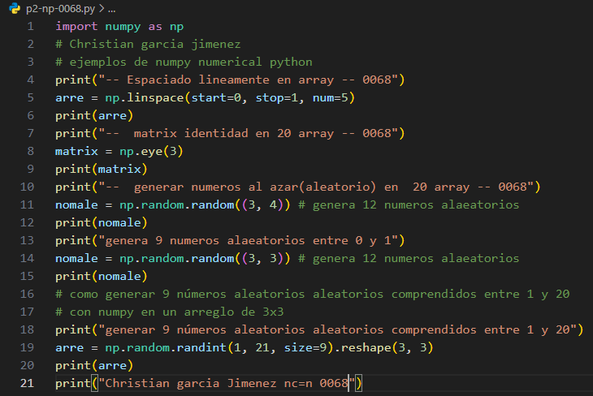
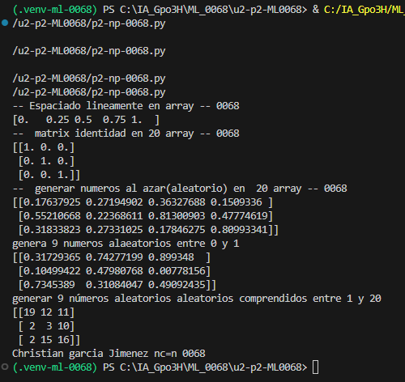

- `start=0`: Valor inicial de la secuencia.
- `stop=1`: Valor final que sirve como límite, sin incluirlo.
- `num=5`: Cantidad de valores que se van a generar.

## Que es  np.linspace
es una función de NumPy que genera números distribuidos uniformemente entre un valor inicial y uno final, indicando cuántos números quieres obtener.
`np.linspace()` genera una cantidad determinada de números distribuidos uniformemente entre un valor inicial y uno final.

## El codigo

## resultado

